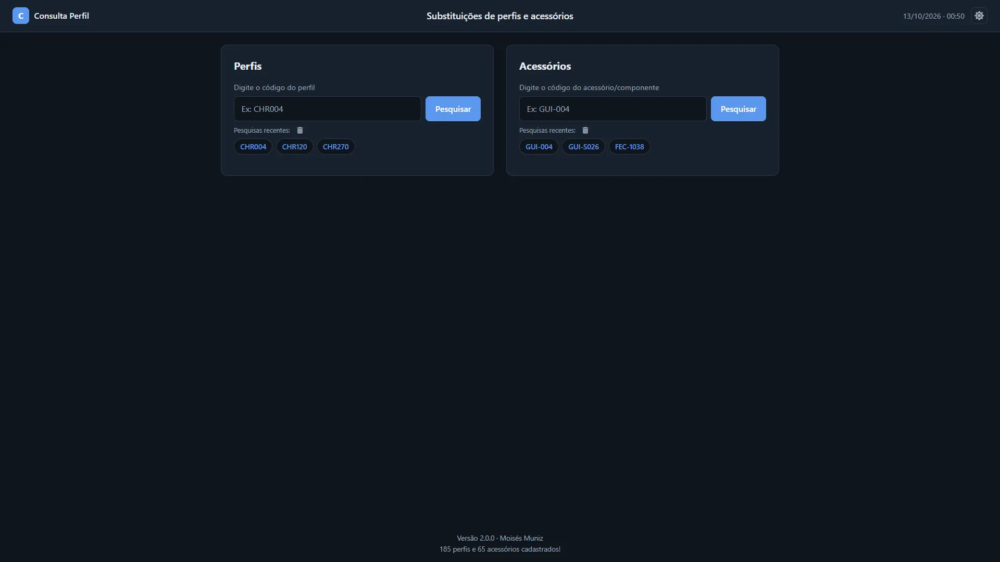
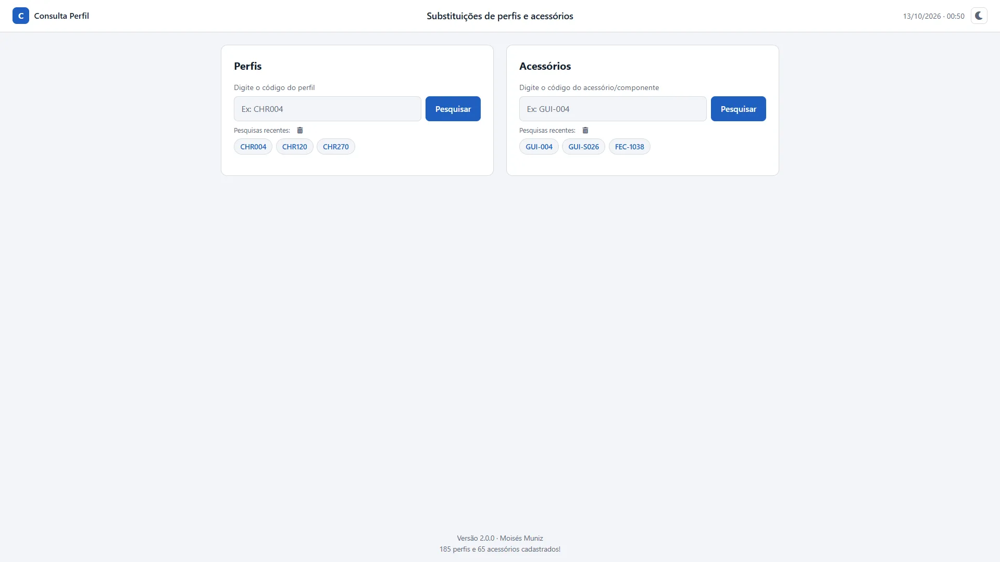
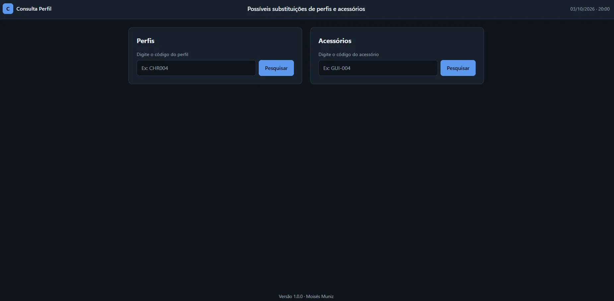

# Consulta Perfil

Sistema para consultar substituições de perfis de alumínio, acessórios e componentes da [Perfil Alumínio do Brasil.](https://perfilaluminio.com.br) Você digita o código e recebe na hora as opções de substituição. Hoje ele também tem o catálogo técnico dos sistemas da empresa, com ficha, cores e modelo 3D.

**Acesse o site:** [Consulta Perfil](https://consultaperfil.com.br/)

### Interface do site

| Modo Escuro | Modo Claro |
| :---: | :---: |
|  |  |

<br>

<details>
<summary><b>Ver versão inicial (v1.0.0)</b></summary>

<br>
<p>Visual da primeira versão do sistema:</p>


</details>

## Por que eu fiz?

Trabalho com vendas na [Perfil Alumínio do Brasil](https://perfilaluminio.com.br) e lido todo dia com perfis de alumínio. São muitos itens e muitos códigos e ninguém consegue lembrar tudo de cabeça. Quando um perfil não está disponível era preciso procurar num bloco de notas qual outro serviria no lugar.

Eu já tinha montado uma planilha de Excel para isso com PROCX, e ela ajudou bastante. O problema é que com vários usuários na mesma planilha online todo mundo acabava mexendo nas mesmas células ao mesmo tempo.

Então peguei essa ideia e transformei em um site: cada pessoa consulta no seu computador, sem editar nada e sem atrapalhar ninguém.

## O que ele faz?

O site tem duas páginas: **Substituições** e **Catálogo Técnico**.

### Substituições

Duas colunas de pesquisa:

- **Perfis:** para perfis de alumínio.
- **Acessórios:** para acessórios e componentes.

Ao pesquisar um código, o resultado mostra a imagem do item original e do substituto, o código que entra no lugar, o nome, a observação e o sistema. Nos acessórios aparecem também o tipo e a unidade de conversão, quando o item tem essas informações.

Também tem:

- **Conversão de sistemas:** lista de perfis da linha Gold com o equivalente no Chroma.
- **Pesquisa inteligente:** sugere resultados enquanto você digita, por código, nome, apelido e observação.
- **Histórico** das 5 últimas pesquisas e botão para **copiar** o código de substituição.
- **Link direto:** `consultaperfil.com.br/?codigo=CHR008` já abre com a pesquisa feita.
- **Ficha completa:** cada resultado tem botões para abrir no Catálogo Técnico a ficha do código que saiu e do substituto. Se o código não tem substituição mas está no catálogo, aparece o botão para a ficha dele.
- Digitando o código novo (ex: `VT230`) aparecem só os códigos que ele substitui.

A pesquisa ignora hífen, asteriscos e maiúsculas/minúsculas, então `GUI-004`, `gui004`, `*GUI004*` e `GUI004` encontram o mesmo item.

Exemplo de perfil:

```text
Código: CHR004

Substituição: CHR120
Nome:         Complemento do Trilho
Observação:   Janela de Correr 2 Folhas
              Somente na cor FOSCO (FO23)
Sistema:      Chroma
```

Exemplo de acessório:

```text
Código: GUI-004

Substituição: -
Nome:         Guia Deslizante 21 mm
Observação:   Guia Deslizante Vedação
Tipo:         PACOTE (PAC)
Und. conv.:   8 PEÇAS
```

### Catálogo Técnico

Reúne os perfis e acessórios de 20 sistemas (Chroma, Ecoline 2.5, Ecostick, Gradline, Sophia e outros), seguindo os catálogos em PDF da empresa.

- **Ficha técnica:** peso, encaixes, tipologia, inércia, observações e gráficos de desempenho.
- **Compatibilidade nos dois sentidos:** o catálogo em PDF escreve o encaixe só em um dos perfis (o CHR003 diz que encaixa no CHR120). O site mostra nos dois, e o perfil também lista os acessórios aplicáveis nele.
- **Imagens:** desenho técnico, modelo 3D e imagem aplicada.
- **Cores:** mostra as cores em que o perfil existe e pinta o desenho e o 3D com a cor escolhida (a cor é aproximada).
- **Modelo 3D:** dá para girar e dar zoom. Hoje está em 959 dos 1000 perfis (todos os sistemas menos a Linha 25, que não tem catálogo) e nos acessórios que são extrudados: guarnições e gaxetas com seção desenhada, espumas, calços e tarucéis (1028 modelos na galeria). A seção sai do desenho do próprio catálogo, na escala dele, e é conferida pelo peso; nos Tabelados ela é montada com as medidas A, B e C da tabela. Ferragens e peças injetadas ficam sem 3D, porque o catálogo não tem como fazer elas fiéis. O material imita o acabamento: natural e anodizado com brilho de metal, branco como pintura, preto e bronze com um reflexo suave.
- **Fora de linha:** se o item saiu de linha, aparece um aviso com botão para ir direto ao substituto.
- **Peso do lote:** calcula o peso pelo número de barras e pelo comprimento. Usa a barra de 6 metros, a não ser que o perfil só seja vendido em outro tamanho (coluna `barra` no Notion, ex.: PS-307 em 6500 mm, CL-006 em 3000 mm).
- **Diversos:** perfil usado em vários sistemas (CL-006, CM-174, VT-957...) fica num registro só. Ele aparece em cada sistema onde é usado, e na ficha o "Onde encaixa" tem um botão por sistema que mostra os perfis que encaixam nele.
- **Copiar imagem:** embaixo do desenho técnico; monta uma ficha com o desenho e as informações do item pra colar direto no WhatsApp, no Chat X ou no e-mail.
- **Comparar:** coloca até 3 itens lado a lado.
- **Busca:** ao trocar de sistema a busca limpa e lista tudo do sistema; dá pra filtrar por tipologia. O exemplo do campo muda com o sistema (pra fixar um exemplo é só mexer em `EXEMPLOS_BUSCA`, no começo do `js/catalogo.js`).
- **Compartilhar:** o link já leva para o item (`consultaperfil.com.br/catalogo?codigo=CHR120&sistema=chroma&aba=perfis`).
- **Pesquise do seu jeito:** escreva algo como "janela de correr 4 folhas" e ele mostra as tipologias com os perfis usados.

No topo tem ainda os **Modelos 3D**, com todos os 1028 modelos numa página só, separados por sistema e por tipo (perfil ou acessório). Eles abrem em preto e dá para trocar a cor de todos de uma vez ou de um modelo só (primeiro as cores padrão: natural, anodizado, preto, branco e bronze). Ao abrir um modelo dá para compartilhar o link dele (`consultaperfil.com.br/modelo3d#CHR057`) ou ir direto para a ficha no Catálogo Técnico.

Quando sai uma versão nova aparece um aviso de **Novidades** com as mudanças, uma vez só (o navegador guarda que a pessoa já viu; dá pra rever no menu do usuário). O texto fica no `NOVIDADES`, no fim do `global.js`, e a versão no `versao_atual`, no começo dele.

O uso na empresa é no computador, mas o layout é responsivo e se ajusta a tablet e celular. Abre no modo claro e tem o botão para o modo escuro (o site lembra a escolha). A data e a hora ficam no topo da tela.

## Como foi feito

Comecei simples, sem banco de dados e sem servidor: era só HTML, CSS, JavaScript e um arquivo JSON com todos os itens.

Com o catálogo o JSON ficou grande demais para manter na mão, então hoje funciona assim:

```text
Notion (onde os dados são cadastrados)
   ↓
API em Flask no Render (lê o Notion e guarda tudo na memória)
   ↓
Site no GitHub Pages (HTML, CSS e JavaScript puro)
```

- Os dados ficam em tabelas do **Notion**: uma de substituição de perfis, uma de acessórios e, para cada sistema do catálogo, tabelas de perfis, acessórios e gráficos.
- A **API** lê tudo do Notion quando sobe e guarda na memória, para o site não depender do Notion a cada pesquisa.
- O **site** continua estático. Ele pede os dados para a API uma vez e faz a busca no navegador.

O Render gratuito dorme quando fica sem uso. No primeiro acesso depois disso a API precisa acordar e ler o Notion de novo, e o site mostra um aviso de "carregando" enquanto espera (pode levar até 1 minuto).

## Tecnologias

- HTML, CSS e JavaScript puro
- [Three.js](https://threejs.org/) para o visualizador 3D
- Python e Flask na API
- Notion como banco de dados
- Render (API) e GitHub Pages (site)

## Estrutura

```text
consulta-perfil/
├── index.html          página de Substituições
├── catalogo.html       página do Catálogo Técnico
├── modelo3d.html       Modelos 3D: todos os modelos numa página
├── global.js           funções usadas em todas as páginas (cabeçalho, tema, API_URL e o aviso de novidades)
├── css/
│   ├── layout.css      cabeçalho, temas e o que é comum
│   ├── style.css       Substituições
│   └── catalogo.css    Catálogo Técnico
├── js/
│   ├── script.js       Substituições
│   ├── catalogo.js     Catálogo Técnico
│   └── viewer3d.js     visualizador dos modelos .stl
├── assets/
│   ├── img/            imagens dos perfis, acessórios e prints
│   ├── models/         modelos 3D (.stl), uma pasta por sistema (chroma/, ecoline/...)
│   └── js/             three.min.js
├── app.py              API em Flask
├── notion.py           leitura das tabelas do Notion
├── sistemas.py         lista dos sistemas do catálogo
├── fotos.py            liga as fotos aos códigos pelo nome do arquivo
├── cores.py            tabela de cores
├── requirements.txt
└── README.md
```

## Rodando no computador

```bash
pip install -r requirements.txt
python app.py
```

A API sobe em `http://127.0.0.1:5000`. Ela precisa de um arquivo `.env` na raiz com o token e os IDs das tabelas do Notion:

```text
NOTION_TOKEN=...
ID_SUB_PERFIS=...
ID_SUB_ACESSORIOS=...
ID_CAT_PERFIS_CHROMA=...
ID_CAT_ACESSORIOS_CHROMA=...
ID_CAT_GRAFICOS_CHROMA=...
(as três linhas ID_CAT_ se repetem para cada sistema: ECOLINE, ECOSTICK, GRADLINE...)
ID_TIPOLOGIAS=...
```

Depois é só abrir o `index.html` com um servidor local (uso o Live Server do VS Code). No site no ar os endereços ficam sem o `.html` (`/catalogo`, `/modelo3d`); rodando no computador o `.html` continua, porque o Live Server não acha a página sem ele (quem decide é o `linkPagina`, no `global.js`). Para o site usar a API local, troque a linha comentada do `API_URL` no começo do `global.js` (e volte para a do Render antes de publicar).

## Rotas da API

| Rota | O que faz |
| --- | --- |
| `/api/substituicoes` | perfis e acessórios da página de Substituições |
| `/api/catalogo` | sistemas, cores, tipologias, perfis, acessórios e gráficos do catálogo |
| `/api/catalogo/codigos` | só a lista de códigos do catálogo (a página de Substituições usa pros botões de ficha completa) |
| `/api/sync` | lê tudo do Notion de novo (roda por fora e responde na hora) |
| `/api/sync/substituicoes` | atualiza só as substituições (todas as rotas de sync respondem na hora e rodam por fora) |
| `/api/sync/catalogo` | atualiza só o catálogo |
| `/api/sync/sistema/<nome>` | atualiza um sistema, ex: `/api/sync/sistema/chroma` |
| `/health` | mostra se está no ar, a última sincronização, as quantidades e os erros |

## Como atualizar os dados

1. Cadastrar ou alterar o item na tabela do Notion (o item só aparece no site com o status **Publicado**).
2. Clicar no botão **Sincronização com o site**, na página Base de Dados do Notion. Ele chama a rota `/api/sync`.
3. Conferir em `/health` se a sincronização terminou e se não teve erro.

As imagens ficam em `assets/img/` e os modelos 3D em `assets/models/<sistema>/`. No Notion vai só o caminho do arquivo, nos campos `imagem`, `imagem_3d` e `imagem_aplicavel`.

As fotos do catálogo também entram sozinhas pelo nome do arquivo, sem mexer no Notion (`fotos.py`):

- `assets/img/catalog/sistemas/<sistema>/acessorio/normal/BRA-702.webp` é a foto do BRA-702 (`aplicada/` vai pra imagem aplicada e `3D/` pra imagem 3D).
- Vários códigos separados por `_` (`BRA-702_BRA-703_BRA-704.webp`): a foto vale pra todos eles.
- `_2`, `_3` no fim (`CL006_2.webp`): é a 2ª, a 3ª foto do item.
- Perfil do Diversos procura na pasta `diversos/` e nas pastas dos sistemas onde ele é usado.
- Gráficos em `<sistema>/graficos/` pelo código ou combinação (`FCV-001.webp`, `VT798_VT781.webp`): `_2` é o segundo gráfico do perfil, `_H` e `_L` são os desenhos das medidas que aparecem como observação embaixo do gráfico.

## Versão Atual

**v4.5.0**

### Planejado

**Fase 1 — Essenciais**
- [x] Pesquisa inteligente com sugestões ao digitar
- [x] Copiar código de substituição com 1 clique
- [x] Botões de pesquisar e limpar
- [x] Histórico das 5 últimas pesquisas

**Fase 2 — Refinamento & UI**
- [x] Campo inteligente que ignora maiúsculas, espaços, hífens e asteriscos
- [x] Painel de status (total de perfis, acessórios e versão)
- [x] Alternância para Modo Claro ou Escuro

**Fase 3 — Funcionalidades úteis**
- [ ] Favoritos
- [x] Comparar perfis
- [ ] Histórico completo de pesquisas
- [x] Link compartilhável por URL (ex: `?codigo=CHR120`)
- [ ] Exportação de relatório em texto, PDF e Excel

**Fase 4 — Técnicas**
- [ ] Login por matrícula
- [x] Backend com Python e Flask
- [ ] Top consultas (ranking dos mais pesquisados)
- [ ] Portal administrativo
- [x] Integração Notion
- [ ] Logs de consulta

**Fase 5 — Futuro**
- [x] Visualização 3D
- [x] Visualização de aplicável
- [ ] Dashboard avançado
- [ ] Relatórios inteligentes

**Fase 6 — IA**
- [ ] IA para recomendações
- [ ] Busca visual por perfil
- [ ] Comparação por similaridade
- [ ] Identificação automática de perfil
- [ ] Retorno dos 3 itens mais parecidos
- [ ] Indicação de substituições compatíveis

## Autor

**Moisés Muniz**

Estudante de Ciência da Computação. Veja meus outros projetos no [portfólio](https://munizmoises.github.io/portfolio/).
